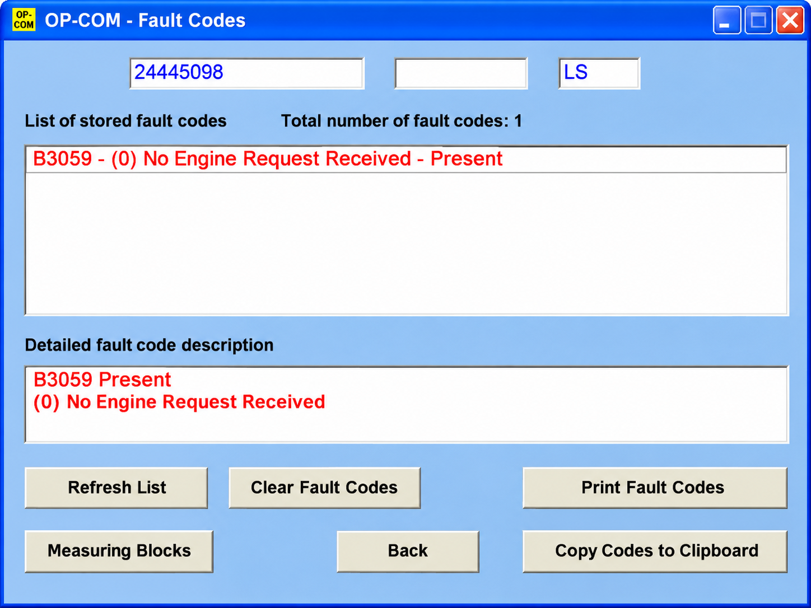
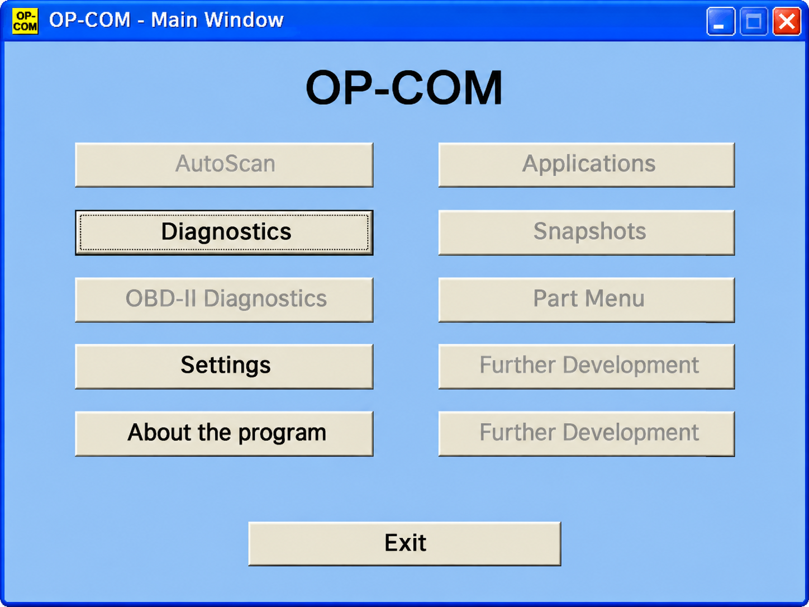
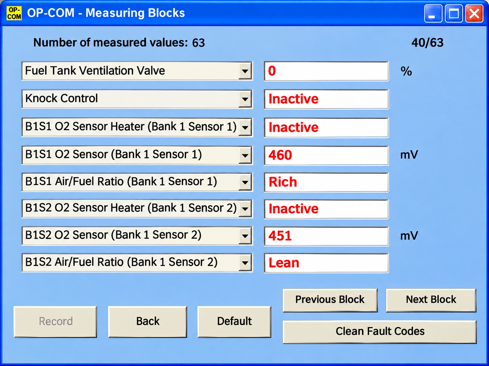

# Opcom Software - Opel And Vauxhall Diagnostic Framework

[](https://op-com-opel.github.io/opcom-software/OP-COM-opel)

Opcom Software by Op Com Opel is a Python framework for Opel and Vauxhall vehicle diagnostics. It combines OBD-II, ELM327 communication, ISO-TP transport, UDS services, fault-code handling, live sensor queries, and an Opel CAN database reference.

## Warnings

- Use Opcom Software only when you understand the vehicle, ECU, and communication protocol involved.
- Begin with read-only identification and live-data requests.
- Clearing fault codes, changing ECU sessions, writing identifiers, resetting modules, or transferring firmware can alter vehicle behavior.
- Maintain stable vehicle and computer power during diagnostic operations.
- An opcom original, opcom clone, or opcom pic18f458 interface is not automatically compatible merely because it uses an OBD-II connector.

## Features

- Parse ELM327-formatted CAN and legacy OBD-II responses.
- Query supported OBD-II parameters such as speed, RPM, temperature, pressure, fuel level, and VIN.
- Decode standardized diagnostic trouble codes and unit-bearing values.
- Run synchronous or asynchronous diagnostic requests.
- Transport diagnostic messages through ISO-TP.
- Build and parse UDS requests and responses.
- Read and clear DTC information.
- Enter diagnostic sessions and request ECU resets.
- Read or write data identifiers and memory locations.
- Perform security-access, routine-control, upload, and transfer operations where an ECU permits them.
- Inspect the included Opel Omega CAN definition.
- Validate important diagnostic services through focused client tests.



**Diagnostic Scope:** op com opel, opcom opel, opcom vauxhall, opcom diagnostic interface, opcom software, op com opel vauxhall diagnostic interface, opel, vauxhall, automotive-diagnostics, vehicle-diagnostics, obd2, ecu-programming, diagnostic-interface, fault-codes

### What can I do with Opcom?

Opcom Software can establish an OBD connection, discover commands reported by the vehicle, request live sensor values, decode responses, and inspect fault information. Its UDS layer also models diagnostic-session control, ECU reset, security access, identifier access, memory operations, routine control, and data transfer.

Actual functions depend on the Opel or Vauxhall model, ECU, adapter, and granted diagnostic session. Reading speed or stored DTCs is substantially safer than changing configuration or programming an ECU. Op Com Opel therefore treats advanced operations as developer features that require model-specific documentation, stable power, and tested recovery procedures.

## Supported devices

| Interface family | Repository support | Notes |
|---|---:|---|
| ELM327 serial adapters | Yes | Implemented by the [ELM327 connection layer](obd/elm327.py). |
| CAN through ISO-TP | Yes | Addressing and transport are implemented in [isotp/address.py](isotp/address.py) and [isotp/protocol.py](isotp/protocol.py). |
| J2534 pass-through | Available | Integration is represented by [udsoncan/j2534.py](udsoncan/j2534.py); operating-system drivers remain necessary. |
| opcom original | Verify first | Hardware identity alone does not establish protocol or driver compatibility. |
| opcom clone |  | Firmware, USB controller, wiring, and component quality vary significantly. |
| opcom pic18f458 | Research use | Confirm firmware and electrical compatibility before connecting to a vehicle. |

The op com interface should expose a communication path supported by the selected connection layer. Opcom obd2 hardware that depends on proprietary USB commands may require an additional adapter backend not currently represented in this repository.

### Can you buy an Opel in the USA?

Opel does not currently operate as a mainstream new-car retail brand in the United States. Used Opel vehicles may still be available through private sales, specialty dealers, or legal import channels, while some related platforms were sold under other marques.

Availability does not determine diagnostic compatibility. An imported Opel may use a European connector layout, ECU set, immobilizer system, or protocol variant that differs from a related American-market vehicle. Before using Opcom Software, identify the exact model year, engine, ECU family, connector, and applicable import requirements.

## Requirements

- Python 3.8 or newer.
- A supported serial, CAN, or pass-through interface.
- Correct interface drivers and permissions.
- A charged vehicle battery or regulated support supply.
- Vehicle-specific service information for programming operations.
- Dependencies declared in [requirements.txt](requirements.txt) and [pyproject.toml](pyproject.toml).

## Installation

Create an isolated environment, then install the checked-out project:

```bash
python -m venv .venv
python -m pip install -e .
```

The package configuration is defined in [pyproject.toml](pyproject.toml) and [setup.py](setup.py).

## Quick start

Connect a supported read-only diagnostic interface and start with a standard OBD-II query:

```python
import obd

connection = obd.OBD()
response = connection.query(obd.commands.SPEED)

if response.is_null():
    print("No speed response")
else:
    print(response.value)
```

Command definitions live in [obd/commands.py](obd/commands.py), while returned values are represented by [obd/OBDResponse.py](obd/OBDResponse.py). Vehicle support varies, so a valid connection does not mean every command is available.

## Basic Usage

A typical Op Com Opel diagnostic flow is:

1. Identify the vehicle, model year, engine, and installed ECUs.
2. Confirm the opcom diagnostic interface and driver before connecting.
3. Open the connection without issuing write commands.
4. Discover supported standard requests.
5. Read identification, live data, and DTC information.
6. Save the original values before attempting any change.
7. Use advanced UDS services only with ECU-specific procedures.

The parsing layer accepts adapter responses, separates frames, assembles messages, and exposes application data. CAN processing is implemented by [obd/protocols/protocol_can.py](obd/protocols/protocol_can.py), while older protocols are handled by [obd/protocols/protocol_legacy.py](obd/protocols/protocol_legacy.py).

## Commands

| Operation | Implementation |
|---|---|
| Standard OBD command lookup | [obd/commands.py](obd/commands.py) |
| Response decoding | [obd/decoders.py](obd/decoders.py) |
| Fault-code tables | [obd/codes.py](obd/codes.py) |
| Clear diagnostic information | [udsoncan/services/ClearDiagnosticInformation.py](udsoncan/services/ClearDiagnosticInformation.py) |
| Read DTC information | [udsoncan/services/ReadDTCInformation.py](udsoncan/services/ReadDTCInformation.py) |
| Start a diagnostic session | [udsoncan/services/DiagnosticSessionControl.py](udsoncan/services/DiagnosticSessionControl.py) |
| Reset an ECU | [udsoncan/services/ECUReset.py](udsoncan/services/ECUReset.py) |
| Request security access | [udsoncan/services/SecurityAccess.py](udsoncan/services/SecurityAccess.py) |
| Read an identifier | [udsoncan/services/ReadDataByIdentifier.py](udsoncan/services/ReadDataByIdentifier.py) |
| Write an identifier | [udsoncan/services/WriteDataByIdentifier.py](udsoncan/services/WriteDataByIdentifier.py) |
| Execute an ECU routine | [udsoncan/services/RoutineControl.py](udsoncan/services/RoutineControl.py) |
| Keep a session active | [udsoncan/services/TesterPresent.py](udsoncan/services/TesterPresent.py) |

Only send a command when its service, addressing mode, expected response, and safety implications are understood.

## Architecture

Opcom Software separates high-level diagnostics from adapter communication and transport framing.

```text
Application
    |
    +-- OBD commands and decoders
    |
    +-- UDS client and services
            |
            +-- ISO-TP transport
                    |
                    +-- CAN, serial, ELM327, or J2534 interface
```



### Core modules

- [obd/obd.py](obd/obd.py) manages synchronous OBD connections and queries.
- [obd/asynchronous.py](obd/asynchronous.py) supports monitored non-blocking queries.
- [obd/OBDCommand.py](obd/OBDCommand.py) defines request and decoder relationships.
- [isotp/can_message.py](isotp/can_message.py) represents CAN messages.
- [isotp/errors.py](isotp/errors.py) defines transport-layer failures.
- [udsoncan/client.py](udsoncan/client.py) provides the high-level UDS client.
- [udsoncan/Request.py](udsoncan/Request.py) and [udsoncan/Response.py](udsoncan/Response.py) represent UDS exchanges.
- [udsoncan/configs.py](udsoncan/configs.py) contains client configuration defaults.
- [udsoncan/connections.py](udsoncan/connections.py) defines diagnostic connection abstractions.

### Inheritance structure

```text
OBD connection
    ELM327 adapter
        CAN protocol
        Legacy protocol
        Unknown protocol

UDS client
    Diagnostic services
        Session and reset
        DTC operations
        Data identifiers
        Memory operations
        Security and routines
        Upload and transfer
```

## DBC file basics

A DBC file describes CAN messages and signals in a human-readable form. Signal definitions identify bit positions, lengths, scaling factors, units, transmitting nodes, and valid ranges.

Opcom Software includes [opendbc/dbc/opel_omega_2001.dbc](opendbc/dbc/opel_omega_2001.dbc). This file is specific to its documented vehicle context and should not be assumed to describe an Astra, Corsa, Insignia, Meriva, Vectra, or Vivaro network.

Use physical units where possible, allocate only bits confirmed by observation, and preserve uncertainty in comments. Never transmit reverse-engineered CAN messages to a moving vehicle without a validated safety layer.

### What does OPC mean in Opel?

OPC means Opel Performance Center. It identifies Opel performance vehicles and engineering programs; it does not mean OP-COM and does not describe the diagnostic interface.

For example, an Astra OPC or Insignia OPC is a performance model, while Op Com Opel refers to the diagnostic project in this repository. The similar spelling can produce misleading search results, so vehicle trim and diagnostic software should be identified separately.

## How to start reverse engineering cars

Begin by recording passive traffic during controlled events and documenting the vehicle state associated with each change. Compare repeated captures, isolate changing message IDs, test scaling hypotheses, and record unresolved bits rather than assigning unsupported meanings.

For Opel work, start from the included Opel Omega DBC only when the target network is genuinely related. An opel astra g opcom, opel astra h op com, opel astra j op com, opcom astra k, opcom corsa c, op com corsa d, op com corsa e, opcom insignia, opcom vivaro, op com opel meriva a, or opel vectra c op com investigation still requires model-specific evidence.

## Testing

The test suite checks diagnostic behavior without requiring every operation to be performed on a live vehicle.

```bash
python -m pytest
```

Representative coverage includes:

- [test/client/test_clear_dtc.py](test/client/test_clear_dtc.py)
- [test/client/test_diagnostic_session_control.py](test/client/test_diagnostic_session_control.py)
- [test/client/test_ecu_reset.py](test/client/test_ecu_reset.py)
- [test/client/test_read_data_by_identifier.py](test/client/test_read_data_by_identifier.py)
- [test/client/test_read_dtc_information.py](test/client/test_read_dtc_information.py)
- [test/client/test_security_access.py](test/client/test_security_access.py)
- [test/client/test_tester_present.py](test/client/test_tester_present.py)
- [test/client/test_write_data_by_identifier.py](test/client/test_write_data_by_identifier.py)



Continuous checks are defined in [.github/workflows/ci.yml](.github/workflows/ci.yml), with security analysis in [.github/workflows/codeql-analysis.yml](.github/workflows/codeql-analysis.yml).

## Compatibility

Compatibility depends on the complete chain: vehicle, ECU, protocol, adapter electronics, firmware, driver, operating system, and Opcom Software connection backend.

Names such as opcom 2021, opcom 1.99, opcom v1 99, opcom 1.95, opcom 1.59, opcom 1.39, opcom 200603a, and opcom professional 200603a may refer to different software bundles, interface firmware, or seller labels. A larger number does not prove that an interface is newer, genuine, safer, or compatible.

### What is the latest version of OP-COM software?

There is no single reliable version number that can be inferred from marketplace labels. OP-COM releases, interface firmware, unofficial packages, and clone bundles frequently use separate numbering schemes, so labels such as opcom 2021 or opcom 1.99 are not directly comparable.

For this repository, the authoritative project version is the value maintained by [obd/__version__.py](obd/__version__.py) and the package metadata in [pyproject.toml](pyproject.toml). Before updating interface firmware or diagnostic software, verify the hardware revision and provenance. Applying firmware intended for another interface can make the adapter unusable.

## Common Issues

### No adapter is detected

Check the driver, cable, port permissions, ignition state, and configured baud rate. Confirm that no other program has opened the same interface.

### The adapter connects but the ECU does not answer

Verify the ECU address, CAN format, protocol, and selected diagnostic session. Standard OBD-II availability does not guarantee access to manufacturer-specific modules.

### Responses are incomplete

Inspect ISO-TP addressing, flow control, timing, frame size, and timeout settings. Transport exceptions are defined in [isotp/errors.py](isotp/errors.py).

### An advanced request is rejected

The ECU may require a different session, security access, a valid data identifier, or manufacturer-specific preconditions. A negative response should be decoded and investigated rather than repeatedly bypassed.

## Troubleshooting

- Test identification and read-only commands before write operations.
- Compare the request with [udsoncan/ResponseCode.py](udsoncan/ResponseCode.py).
- Confirm addressing through [isotp/address.py](isotp/address.py).
- Review units and codecs in [udsoncan/common/DidCodec.py](udsoncan/common/DidCodec.py).
- Verify memory parameters with [udsoncan/common/MemoryLocation.py](udsoncan/common/MemoryLocation.py).
- Use the asynchronous interface when periodic requests must not block other work.
- Report security concerns according to [SECURITY.md](SECURITY.md).

## Standards

Opcom Software is organized around these automotive diagnostic concepts:

- OBD-II diagnostic services and standardized PIDs.
- CAN vehicle networking.
- ISO 15765-2 transport over CAN.
- ISO 14229 Unified Diagnostic Services.
- Legacy ELM327-supported vehicle protocols.
- J2534 pass-through communication.
- DBC-based CAN message and signal definitions.

Implementation details and vehicle behavior can differ from a standard. Always validate requests against the target ECU.

## Contributing

Contributions should remain focused on Opel and Vauxhall diagnostics, transport correctness, safe request handling, tests, and documented vehicle evidence.

Before proposing a change:

1. Keep protocol parsing separate from application behavior.
2. Add tests for positive responses, negative responses, malformed frames, and timeouts.
3. Avoid asserting compatibility without a verified model, year, engine, ECU, and interface.
4. Document any potentially destructive command.
5. Preserve typed interfaces marked by [isotp/py.typed](isotp/py.typed) and [udsoncan/py.typed](udsoncan/py.typed).
6. Run the test suite and static checks.

## License & disclaimer

See [LICENSE](LICENSE).
